  

<h3 align="center">
  
</h3>

  
  
  
  

  

---

## About Me

I'm a Computer Science undergraduate at **GITAM University, Hyderabad**, interested in building intelligent systems that bring together machine learning, software engineering, and infrastructure.

I work across AI-powered safety intelligence, agentic systems, NLP, and computer vision. I enjoy developing end-to-end applications—from ML pipelines and backend services to dashboards, databases, and containerized deployments.

- Building AI applications with **PyTorch, TensorFlow, and scikit-learn**
- Developing agentic workflows with **LangGraph, MCP, and LLM APIs**
- Exploring **NLP, semantic search, RAG, and computer vision**
- Building backend services with **FastAPI, Flask, and PostgreSQL**
- Working with **Docker, Kubernetes, MLflow, and cloud platforms**
- Strengthening my foundations in algorithms, operating systems, databases, and mathematics

---

## Featured Projects

### 01 · NexCord
**Agentic incident management and resolution for live events**

An agentic incident commander designed to identify scheduling and resource conflicts, analyze incidents, and propose actionable response plans.

- Designed an **observe → analyze → approve → execute → verify → recover** workflow.
- Added human approval before consequential actions, with verification after execution.
- Integrated **LangGraph** agents with a self-hosted **MCP** server for tool execution.
- Used **PostgreSQL and pgvector** for persistent application state and semantic retrieval, with an emphasis on auditability and recovery from failed actions.

**Tech:** Python · LangGraph · MCP/FastMCP · PostgreSQL · pgvector  
**Repository:** [msaimanish/NexCord](https://github.com/msaimanish/NexCord)

### 02 · SIFSentinel
**AI-powered safety intelligence platform**

An AI/NLP platform that identifies potential **Serious Injury and Fatality (SIF) precursors** in incident reports, near-misses, and unsafe-condition reports.

- Implemented SIF classification, precursor extraction, **IOGP Life-Saving Rule** mapping, and risk-based prioritization.
- Integrated sentence embeddings with **PostgreSQL/pgvector** to retrieve semantically similar historical reports.
- Developed an interactive safety analytics dashboard to help teams identify reports requiring attention.
- Containerized the Next.js frontend, FastAPI backend, PostgreSQL database, and asynchronous ML worker with **Docker Compose**.

**Tech:** Python · scikit-learn · PyTorch · FastAPI · PostgreSQL · pgvector · Next.js · Docker  
**Repository:** [msaimanish/sifsentinel-final](https://github.com/msaimanish/sifsentinel-final)

### 03 · ClassSense AI
**Real-time classroom attendance and analytics**

A facial-recognition-based system that identifies registered students, automates attendance logging, and supports natural-language attendance analytics.

- Implemented multi-face detection and deep-learning face embeddings for student recognition.
- Integrated **MediaPipe**, **TensorFlow/Keras**, and **Google Cloud Firestore** through the Firebase Admin SDK.
- Built a Flask dashboard for student registration, confidence-based attendance marking, and searchable records.
- Integrated **Gemini** for natural-language attendance analytics.

**Tech:** Python · MediaPipe · TensorFlow/Keras · Flask · Firestore · Gemini  
**Repository:** [msaimanish/ClassSense_AI](https://github.com/msaimanish/ClassSense_AI)

### 04 · Raid Relay
**AI-powered interactive raid experiences for Twitch communities**

An interactive Twitch raid experience that transforms channel handoffs into collaborative, AI-driven quests. Instead of viewers arriving in an unfamiliar stream without context, Raid Relay gives incoming raiders an immediate shared activity, helping streamers turn the first 60 seconds of a raid into an engaging community experience.

- Designed a raid-driven quest system that adapts interactions based on raid size, turning incoming viewers into a collaborative party.
- Developed an AI-powered quest generation workflow that creates contextual challenges for the receiving streamer and incoming community.
- Integrated Twitch channel and raid events to coordinate interactions across participating communities.
- Focused on reducing newcomer friction, encouraging participation, and creating memorable interactions between streamers and their audiences.

**Tech:** Python · Twitch API / EventSub · LLM APIs · Agentic AI  
**Repository:** [msaimanish/Raid-Relay](https://github.com/msaimanish/Raid-Relay)

---

## Open Source

- **Matplotlib:** Contributed a documentation fix to hide the version warning banner on the development documentation pages. [PR #32543](https://github.com/matplotlib/matplotlib/pull/32543) — merged.

---

## Hackathon Projects

### Slidesmart — EduHacks
An AI-powered educational tool that turns long YouTube videos and text documents into concise, visually engaging presentation slides.

- Used **AssemblyAI** and **Azure Text Analytics** for summarization and key-phrase extraction.
- Worked on a **Stable Diffusion** image-generation pipeline and explored **WebAssembly (Wasm)** for faster inference.
- Developed the web application with **Django, Python, HTML, and CSS**.

**Tech:** Python · Django · AssemblyAI · Azure Text Analytics · Stable Diffusion · Wasm

### tPay — NewHacks
A facial-recognition payment authentication prototype designed for campus payments.

- Built a transfer-learning pipeline with **MobileNet, TensorFlow, and Keras**, trained on **3,000+ facial images** and negative samples.
- Integrated recognition into a **Django** application with an SQL database for registration, identity verification, and payment authentication.

**Tech:** Python · TensorFlow/Keras · MobileNet · Django · SQL

### Weed Detech — Harvest Hacks
A computer-vision application that identifies and localizes weeds in crop images to support targeted pesticide use.

- Developed the **Streamlit** frontend and helped integrate it with the team’s **ConvNeXt** object-detection pipeline.
- Contributed to integrating a transfer-learned model trained on **Google Cloud TPUs**, returning bounding boxes for detected weeds.

**Tech:** Python · Streamlit · Computer Vision · ConvNeXt · Google Cloud TPUs

---

## Awards & Hackathons

| Date | Event | Result | Project |
|:---|:---|:---|:---|
| **Sep 2026** | Smart India Hackathon | **Internal Round Qualifier** — qualified among 154 teams | SIFSentinel · Oil India Limited problem statement 26165 |
| **Dec 2022** | EduHacks · Major League Hacking (MLH) | **First Overall** | Slidesmart |
| **Nov 2022** | NewHacks · Major League Hacking (MLH) | **Synopsys Smart Everything Sponsor Prize** | tPay |
| **Nov 2022** | Harvest Hacks · Major League Hacking (MLH) | **2nd Place Overall** | Weed Detech |

---

## Experience & Leadership

**G-ELECTRA Tech Club — GITAM University**  
*Web Development Lead · August 2025 – August 2026*

- Led development of two websites for tech-fest promotion, event information, and participant engagement.
- Collaborated with a team to integrate interactive 3D features and build responsive web experiences.
- Improved rendering performance, UI responsiveness, and cross-device compatibility.

---

## Tech Stack

  
   
  
   
  
   
  

  
<strong>Detailed technical skills</strong>

   

  **Languages & Web:** Python · C++ · JavaScript · SQL · HTML · CSS · Next.js · Three.js · Streamlit

  **AI / ML / NLP:** PyTorch · TensorFlow/Keras · scikit-learn · XGBoost · OpenCV · MediaPipe · NumPy · Pandas · Hugging Face · Sentence Embeddings · RAG · Computer Vision · NLP

  **Agentic AI & LLMs:** LangGraph · MCP / FastMCP · Amazon Bedrock / Nova · Gemini API

  **Backend & Databases:** FastAPI · Flask · Django · PostgreSQL · pgvector · Firestore

  **MLOps, Infrastructure & Cloud:** Git · Docker · Docker Compose · Kubernetes · Linux · MLflow · Google Cloud Platform · AWS

  **Computer Science:** Data Structures & Algorithms · Object-Oriented Programming · Operating Systems · DBMS

---

## GitHub Activity

  
  

  

### Contribution Activity

<!-- BEGIN ACTIVITY-GRAPH -->
<picture>
  <source media="(max-width: 767px)" srcset="activity-graph-mobile.svg">
  
</picture>
<!-- END ACTIVITY-GRAPH -->

### Contribution Snake

  <picture>
    <source media="(prefers-color-scheme: dark)" srcset="https://raw.githubusercontent.com/msaimanish/msaimanish/output/github-contribution-grid-snake-dark.svg" />
    <source media="(prefers-color-scheme: light)" srcset="https://raw.githubusercontent.com/msaimanish/msaimanish/output/github-contribution-grid-snake.svg" />
    
  </picture>

---

## Education

**GITAM University — Hyderabad, India**  
Bachelor of Technology in Computer Science · **2024 – Expected April 2028**  
CGPA: **9.67/10.0**

Relevant coursework: Data Structures, Design and Analysis of Algorithms, Operating Systems, Database Management Systems, Object-Oriented Programming, Probability and Statistics, Linear Algebra, Calculus and Differential Equations.

---

  <em>Building intelligent systems through machine learning, thoughtful engineering, and continuous experimentation.</em>

  

